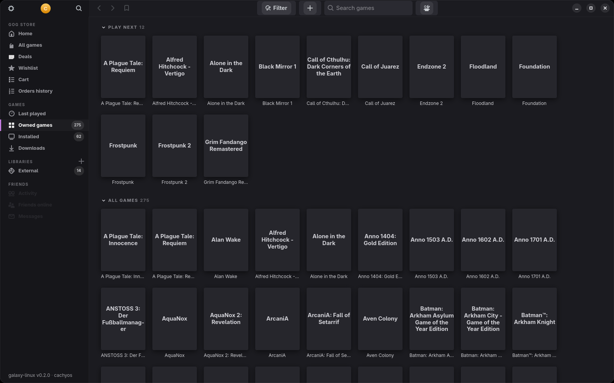

# galaxy-linux

An unofficial, native **GOG.com client for CachyOS / Arch Linux**, modelled on GOG Galaxy 2.x – a GTK4/libadwaita
app plus a command line tool. It rebuilds the client natively and talks to the GOG services the way Galaxy does
(login, library, content system v2, GamesDB, gameplay API, cloud storage), and adds what Linux needs: Proton/Wine
per game, prefixes and GOverlay.



## Features

- **Library like Galaxy** – owned, installed and last played games, custom libraries for non-GOG games (official
  names and covers, copies shown once), grid/list views, tags, star ratings, sort/group/filter, sidebar bookmarks,
  right-click menu and *Edit …* for a custom title and cover. New purchases show up on their
  own; ⚙ → *Refresh library* (F5) forces a sync. Power Search with Ctrl+F (library, bookmarks, store).
- **Discover, Recent and a notification center** – store shelves (for you, new arrivals, deals, wishlist, DLC, Good Old
  Games) in your currency, a Recent view with playtime stats and *What to play next*, a bell for downloads, updates,
  new games, cloud saves and wishlist discounts.
- **Friends** – friends list with presence and *Playing …*, invites (accept/decline), a friends sidebar on wide
  windows, *Friends playing now* and *Activity* in Recent, notifications, and GOG's chat web app under *Messages*.
- **Self-update like Galaxy** – ⚙ → *Check for updates* (and once a day at start) looks for a new GitHub release and
  shows its notes; *Update now* checks the package against `SHA256SUMS`, installs it through the system's polkit
  prompt (`pkexec pacman -U`) and restarts.
- **Game view with Overview / My progress / Extras** – achievements with rarity, offline installers and goodies,
  cloud saves backup; *Configure …* for game language, version rollback, beta/private channels, DLCs and custom
  executables.
- **Downloads like Galaxy** – pause/resume, reorder, bandwidth limit with schedule, pause while playing, queue kept
  across restarts, disk space check.
- **Desktop integration** – system tray (StatusNotifierItem), autostart, minimize/close/launch behaviour, online
  status, playtime from all devices; every view fits down to 1280 × 800 (e.g. a 4K TV at 225 % scaling).
- **Embedded GOG store** – home, catalogue, deals, wishlist, cart and order history inside the client; buying a
  game refreshes the library.
- **Installs through GOG's content system** – resumable downloads, updates, verify/repair, DLCs, plus Galaxy's
  redistributables (shared cache, installer scripts, DOSBox/ScummVM).
- **Proton per game** – umu-launcher, proton-cachyos, GE-Proton or Wine, one prefix per game, Proton's Wayland
  driver by default, Steam-style launch options (`mangohud %command%`).
- **GOverlay per game** – every installed game appears in GOverlay once, with its title and cover; its GOverlay
  profile is applied at launch.
- **Galaxy services in game** – achievements, stats and leaderboards for Galaxy SDK games via comet.
- **Cloud saves** – synced before and after playing, with a conflict dialog and local backups.
- Playtime, desktop/menu shortcuts, detection of copied game folders, German and English interface.

## Install

```bash
git clone https://github.com/Cue-System90/gog_like_client_Arch_linux.git
cd gog_like_client_Arch_linux
./install.sh
```

`install.sh` builds the pacman package into `../dist`, removes an older version and installs the new one.
Required: `python python-requests python-gobject gtk4 libadwaita webkitgtk-6.0 unzip xdg-utils`.
Recommended: `umu-launcher proton-cachyos mangohud lib32-mangohud goverlay winetricks gamescope innoextract`.
Update with ⚙ → *Update now* once a release is out, or `git pull && ./install.sh`; remove with
`scripts/uninstall.sh` (`--purge` also deletes settings).

## Usage

- Sign in through the avatar menu, then install or play from a game's page.
- ⚙ menu: add games, redeem a GOG code, scan folders for GOG games, refresh the library, settings.
- Game page → ⚙ *Properties*: Proton/Wine version, launch options, GOverlay profile, cloud saves, prefix setup.
- Language: *Settings → General → Interface*, or `GALAXY_LINUX_LANG=en galaxy-linux`.
- Command line: `galaxy-linux --help` (`list`, `install`, `launch`, `cloud`, `redist`, `comet`, `goverlay`, `library` …).
- Logs: ⚙ → *Log* (filter, search, copy), `~/.local/share/galaxy-linux/logs/` or `galaxy-linux log`.
  Changes: [CHANGELOG.md](CHANGELOG.md).

Development: `python3 -m unittest discover -s tests -t .`; translations are kept with `scripts/i18n-update.py`.

## Legal

Unofficial project, not affiliated with GOG. GOG and GOG GALAXY are trademarks of GOG sp. z o.o. Use at your own
risk: GOG's user agreement prohibits unauthorised third-party programs; open-source clients such as Heroic,
Minigalaxy and Lutris have been tolerated for years, but there is no guarantee. This repository contains no code or
artwork from GOG.

Third-party: [comet](https://github.com/imLinguin/comet) (Apache-2.0) and its GalaxyCommunication dummy service are
downloaded on demand from the official release and checked against a SHA-256 hash.

License: MIT.
